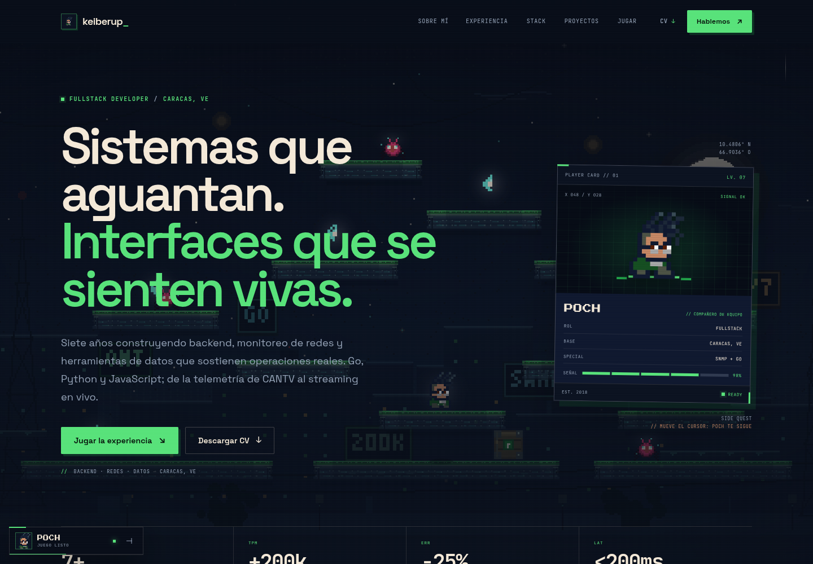
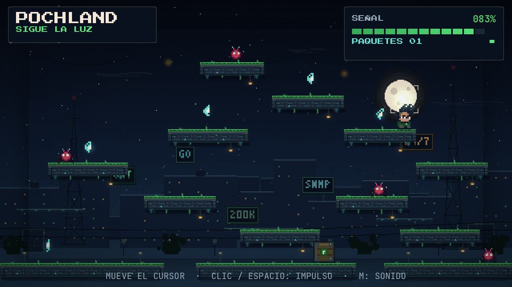
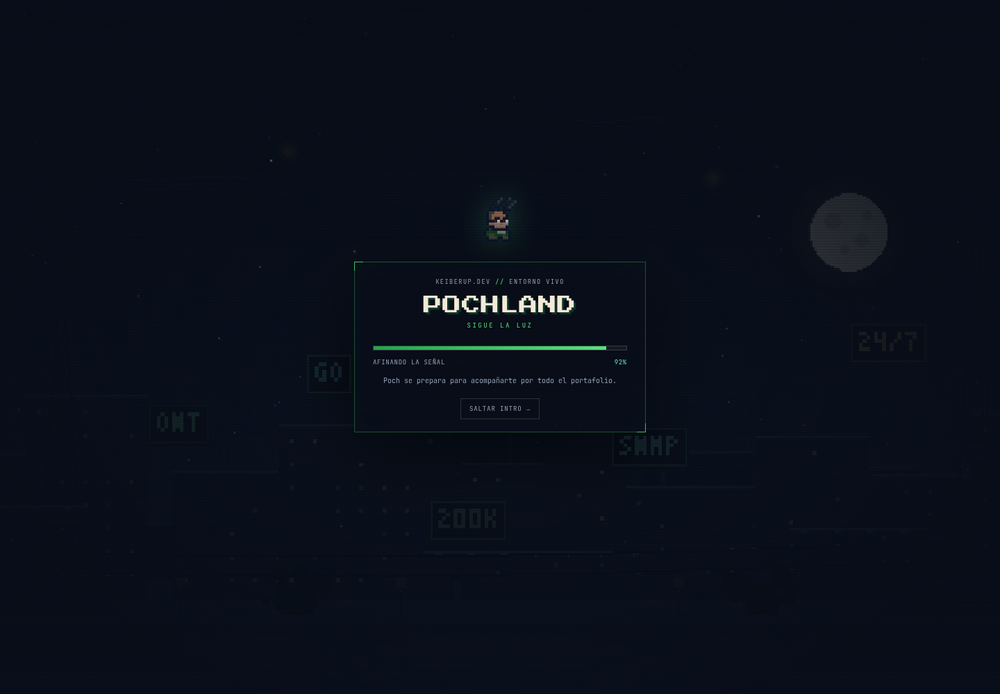
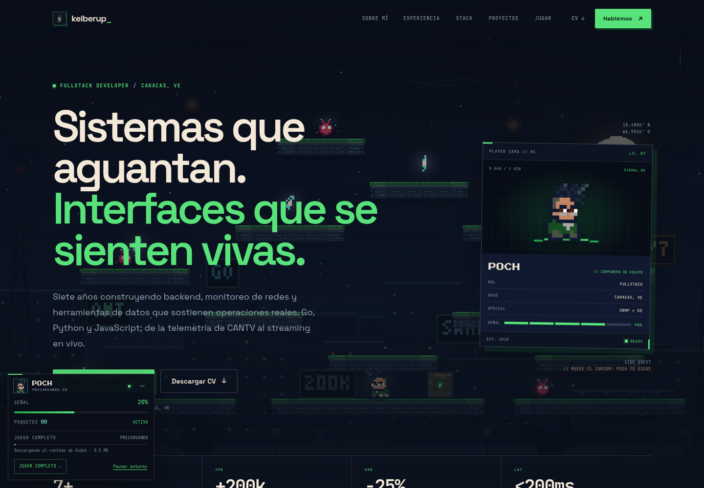

# Keiber Urbila — portafolio + POCHLAND

Portafolio personal de **Keiber Abraham Urbila Padrino** (Fullstack Developer · Backend & Telecomunicaciones) con una experiencia interactiva 2D hecha en **Godot 4.7.2** y exportada para la web.

**POCHLAND · Sigue la luz** tiene dos capas:

1. **Entorno vivo de fondo** en todo el portafolio. Poch recorre el **mismo mapa de 13 plataformas** que el juego: camina, salta, se deja caer, rompe cajas, esquiva bugs y recoge paquetes para llegar lo más cerca posible del cursor. Es un port Canvas 2D ligero de la lógica y los assets de Godot, para no cargar 38 MB de WebAssembly en cada visita.
2. **Juego completo en su sección** (`#jugar`). El build Godot es la experiencia jugable original, con su IA, obstáculos y sonido. Se carga al pulsar “Entrar al juego”.

La intro del entorno se muestra una vez por sesión y da paso a la página. Mientras lees, el runtime de Godot se **precarga en segundo plano** (en escritorio tras la intro; en móvil al acercarte a la sección). Al entrar al juego, el iframe se sirve desde la caché si el hosting envía las cabeceras incluidas.










## Contenido

- **Sitio estático** (`site/`): HTML, CSS y JavaScript sin dependencias ni build step. Una sola página responsive con hero, sobre mí, experiencia, stack, proyectos, contacto y la sección del juego.
- **Entorno ambiental** (`site/assets/js/ambient.js`): Poch sigue al cursor por toda la página, recoge paquetes, esquiva bugs y se pausa solo cuando no debe gastar recursos. Sus assets están en `site/assets/img/ambient/`.
- **Intro y precarga**: boot del entorno, HUD compacto con señal/paquetes y estado de precarga del juego. El runtime Godot se descarga en segundo plano y se reutiliza desde caché.
- **Experiencia Godot** (`experience/`): proyecto Godot 4.7.2 con IA de plataformas, efectos, audio sintetizado, HUD, pantalla de inicio y pausa.
- **Build web** (`site/game/`): export Web single-thread listo para servir. Se carga solo cuando la persona pulsa “Entrar al juego”.
- **CV descargable**: `site/assets/CV-Keiber-Urbila.pdf`.
- **Integración**: iframe con `postMessage` para enviar señal/paquetes/récord al portafolio y recibir pausa, reanudación y mute.
- **Despliegue**: configuración incluida para Vercel (`site/vercel.json`) y Netlify (`site/_headers`).

## Paquetes

- `dist/keiber-urbila-portfolio.zip` — sitio completo listo para desplegar (incluye README y capturas). `index.html` está en la raíz.
- `dist/pochland-godot-source.zip` — proyecto Godot, generadores de assets/audio, sprite original y QA. No incluye el sitio ya exportado.
- `dist/SHA256SUMS.txt` — hashes de ambos paquetes.

El ZIP del portafolio es también el **código fuente del sitio** (HTML, CSS y JS editables). El ZIP de Godot es para abrir `experience/` en el editor y reexportar.

## Ver en local

```bash
cd site
python3 -m http.server 8080
# Abre http://localhost:8080/
```

El juego se descarga al pulsar el botón del póster; después, su propia pantalla de inicio pide **conectar con Poch** (ese segundo clic es el gesto que desbloquea el audio). El `.wasm` ronda los **38 MB sin comprimir** (~9.8 MB en gzip). En un servidor local sin compresión la primera carga tarda unos segundos; en Vercel/Netlify/Cloudflare se sirve comprimido.

También puedes abrir el juego solo en `http://localhost:8080/game/index.html`.

## Estructura del proyecto

```text
.
├── site/                          # lo que se despliega
│   ├── index.html                 # portafolio
│   ├── assets/
│   │   ├── css/styles.css
│   │   ├── js/main.js             # navegación, animaciones, puente del juego
│   │   ├── js/ambient.js          # entorno vivo + precarga del juego
│   │   ├── fonts/                 # locales (sin CDN)
│   │   ├── img/                   # sprite, favicons, OG cover
│   │   ├── img/ambient/           # fondo y sprites del entorno
│   │   └── CV-Keiber-Urbila.pdf
│   ├── game/                      # export Godot
│   │   ├── index.html             # shell de carga propio
│   │   ├── index.js / .wasm / .pck
│   │   └── worklets de audio
│   ├── vercel.json
│   ├── _headers
│   └── .nojekyll
├── experience/                    # proyecto Godot 4.7.2
│   ├── project.godot
│   ├── export_presets.cfg         # preset "Web" · threads OFF
│   ├── scenes/main.tscn
│   ├── src/                       # main, level, player, spark, fx, hud...
│   ├── assets/                    # sprites, audio, fuentes
│   └── web/shell.html             # HTML shell del build
├── tools/                         # generadores de assets/audio/OG y QA
├── raw-assets/                    # sprite original aportado por Keiber
└── docs/                          # capturas para documentación
```

## Controles

| Acción | Entrada |
|---|---|
| Guiar a Poch (fondo) | Mover el cursor / tocar y arrastrar |
| Abrir el panel del entorno | Pulsar el avatar de Poch (abajo a la izquierda) |
| Pausar / activar el entorno | Botón “Pausar entorno” del panel |
| Guiar a Poch (juego completo) | Mover el cursor / tocar y arrastrar |
| Impulso extra en el juego | Clic izquierdo o `Espacio` |
| Silenciar audio del juego | `M` |
| Pausa del juego | Al salir de la sección, cambiar de pestaña o perder el foco |
| Depuración | `F3` (grafo de plataformas y ruta) |

En móvil, al pulsar **Entrar al juego** el sitio entra en pseudo-pantalla completa y muestra una indicación para girar el dispositivo. El juego está pensado en 16:9. El HUD del entorno se oculta al llegar a la sección del juego o al pie de página. El canvas se pausa en la sección del juego, con la pestaña oculta, en pantalla completa o con `prefers-reduced-motion`.

## Integración en otra web

```html
<iframe
  src="/game/index.html"
  title="Pochland, experiencia interactiva en Godot"
  width="960"
  height="540"
  loading="lazy"
  allow="autoplay; fullscreen; gamepad"
  allowfullscreen
></iframe>
```

No hace falta `Cross-Origin-Opener-Policy` ni `Cross-Origin-Embedder-Policy`: el build es **single-thread** y funciona en iframes de terceros, GitHub Pages o itch.io sin headers especiales.

### Puente `postMessage`

El juego solo envía mensajes al `parent` cuando está embebido.

**Juego → página**

```js
{ source: "pochland", type: "ready" }

{ source: "pochland", type: "stats",
  sync: 0..100,       // señal actual
  packets: 0..n,      // paquetes recogidos
  best: 0..100        // mejor señal alcanzada
}

{ source: "pochland", type: "event",
  name: "collect" | "sync" | "jump" }
```

**Página → juego** (`iframe.contentWindow.postMessage(payload, "*")`)

```js
{ source: "pochland-host", type: "pause" }
{ source: "pochland-host", type: "resume" }
{ source: "pochland-host", type: "mute", muted: true }
```

En `site/assets/js/main.js` ya está implementado el listener con comprobación de `event.source`, el lazy-load del iframe, la pausa por `IntersectionObserver`/`visibilitychange`, el HUD y el botón de pantalla completa. El sitio también envía pausa y reanudación al entrar/salir de la sección.

## Decisiones técnicas

- **Godot 4.7.2.stable** con export templates 4.7.2. Renderer **GL Compatibility** para máxima compatibilidad web.
- **Web single-thread** (`variant/thread_support=false`): se puede embeber sin COOP/COEP.
- Resolución base **640×360** (16:9), `stretch mode = canvas_items`, `aspect = keep`. El HUD se escala con el viewport y el juego letterboxea si el contenedor no es 16:9.
- **Un WebAssembly de Godot no es viable como fondo permanente** (38 MB + WebGL continuo detrás de cada sección). Por eso el entorno es un **port Canvas 2D del mapa y la IA**: mismas 13 plataformas, gravedad 1500, salto −470, velocidad 128, aristas balísticas, Dijkstra, drop-through, bugs, cajas y paquetes. El juego real sigue siendo Godot.
- En pantallas amplias el mapa se ajusta entero al viewport; en pantallas estrechas y móvil se usa una cámara que sigue a Poch para mantener plataformas y personaje a un tamaño legible.
- **Precarga real del juego**: se descargan `index.wasm`, `index.pck`, `index.js` y worklets con `fetch`, midiendo bytes. Se omite con `Save-Data`/2G; en móvil espera a que el usuario se acerque a la sección. El iframe sigue siendo lazy.
- Texturas con filtro nearest y arte pixel art; sin dependencias externas en runtime.
- IA determinista sobre un **grafo de plataformas** construido a partir de la física real (gravedad 1500 px/s², salto −470 px/s, velocidad 128 px/s). Las aristas se calculan con balística para que los saltos sean alcanzables.
- Tres tipos de arista: salto, caída caminando y “drop-through” por plataformas de un solo sentido. La ruta se resuelve con Dijkstra y se replanifica cada 0.18 s.
- Obstáculos: cajas que se rompen, bugs que patrullan y provocan un glitch/stun breve, huecos y plataformas suspendidas. Poch esquiva con un salto si detecta un bug en su trayectoria.
- El cursor dibujado dentro del juego es un retículo propio; el cursor del navegador se oculta solo durante la partida (también con CSS en el canvas) y reaparece en pausa.
- Audio sintetizado desde cero (`tools/make_audio.py`): música loop y SFX. El contexto de audio se desbloquea con el clic de entrada.
- **Tamaño**: `.wasm` ~38 MB sin comprimir (~9.8 MB gzip), `.pck` ~471 KB, `.js` ~274 KB. El póster y el iframe se cargan bajo demanda.
- El juego no tiene condición de derrota: es una experiencia ambiental de 1–2 minutos o más. La señal mide cercanía al cursor y los paquetes son el marcador. El sitio muestra el récord de señal de la sesión.

## QA realizado

- **Godot headless self-test**: `PASS`. Visita las 13 plataformas, recoge 6–7 paquetes, rompe cajas, 0 caídas y alcanza 99 % de señal.
  ```bash
  godot --headless --path experience -- --selftest
  ```
- **Chromium headless con WebGL2**: el entorno resolvió rutas y saltos entre plataformas (G0, L3, M2, G2 y R4), registró estados aéreos y recogió paquetes; intro, HUD, precarga, juego completo `EN LÍNEA`, pausa/reanudación, móvil, menú y `prefers-reduced-motion`, sin errores de consola.
- **Precarga y caché**: con las cabeceras de los configs de hosting, el `.wasm` se reutiliza al entrar (medido ~0.2 s frente a ~2.5 s de descarga en local sin caché).
- **Audio**: `AudioContext.state === "running"` después del clic de entrada.
- **Responsive**: sin overflow horizontal entre 320 y 1920 px; menú móvil oculta el HUD del entorno.
- **Assets**: comprobación de enlaces locales, fuentes y todas las referencias del shell de export.

## Cómo editar

### Textos y diseño
- Copy: `site/index.html`.
- Colores, tipografía y layout: variables al inicio de `site/assets/css/styles.css`.
- Sprite de la portada y favicon: `site/assets/img/poch-sheet.png` + `site/assets/img/poch-icon.png`.
- Si publicas en otro dominio, actualiza `canonical`, `og:url`, `og:image`, `sitemap.xml` y los enlaces absolutos del `site/index.html`.

### Entorno de fondo
- Mapa, IA de plataformas, bugs, cajas, paquetes y cámara: `site/assets/js/ambient.js`.
- Fondo, tiles y sprites del entorno: `site/assets/img/ambient/`.
- Intro y HUD: bloques `.ambient-*` en `site/index.html` y `site/assets/css/styles.css`.
- La precarga se controla en `schedulePreload`, `startPreload` y `PRELOAD_FILES` dentro de `ambient.js`.
- El mapa del entorno replica `PLATFORM_DEFS`, `MAP_PACKETS`, `MAP_BUGS` y `MAP_CRATES` de la escena Godot; si cambias el nivel, actualiza ambos.
- Opacidad de plataformas: `drawPlatforms` (`globalAlpha`); escala/cámara: `resize`/`updateOffsets`. En pantallas amplias se ve el mapa completo; en estrechas la cámara acompaña a Poch.

### Juego
- Dificultad y física: `experience/src/level.gd` (`GRAVITY`, `JUMP_VELOCITY`, `RUN_SPEED`, `PLATFORM_DEFS`).
- Rutas, paquetes, bugs, cajas y audio: `experience/src/main.gd` (`PACKET_POSITIONS`, `BUG_SETUP`, `CRATE_POSITIONS`, `SFX_PATHS`).
- Comportamiento/animación: `experience/src/player.gd`; retículo: `experience/src/spark.gd`.
- HUD: `experience/src/hud.gd`; efectos: `experience/src/fx.gd`.

### Regenerar arte y audio

```bash
python3 tools/make_assets.py    # sprites y fondo
python3 tools/make_audio.py     # música y SFX (requiere ffmpeg)
python3 tools/make_og.py        # portada Open Graph
```

El sprite original está en `raw-assets/poch-sheet.png`. El generador de arte necesita que `experience/assets/sprites/poch.png` exista (copia del frame sheet); está incluido en el proyecto.

### Reexportar el build web

Con Godot 4.7.2 y los templates Web instalados:

```bash
godot --headless --path experience --export-release "Web"
```

El preset escribe directamente en `site/game/index.html`. El shell HTML propio está en `experience/web/shell.html` y se referencia desde `experience/export_presets.cfg`.

## Despliegue

### Vercel
```bash
cd site
npx vercel --prod
```
`vercel.json` fija MIME de `.wasm`, caché y cabeceras básicas. No agregues COOP/COEP. La caché de `.wasm`/`.pck` es la que permite que la precarga ahorre la descarga al entrar.

### Netlify
- Drag & drop de la carpeta `site/`, o `netlify deploy --prod --dir site`.
- `_headers` ya define los tipos y caché; mantenlo para que la precarga se reutilice.

### GitHub Pages
- Sube el contenido de `site/` a la rama de Pages. `.nojekyll` está incluido.
- Idealmente sirve desde un host que comprima wasm (Vercel/Netlify/Cloudflare). GitHub Pages puede entregar el wasm sin comprimir según configuración.

### itch.io
- Comprime **solo** `site/game/` con `index.html` en la raíz.
- Sube como proyecto HTML5; itch.io no necesita headers COOP/COEP para este build.
- El botón de entrada y la pantalla de audio siguen funcionando; el HUD del portafolio no se incluye en este modo.

## Créditos y licencias

- Personaje, sprite y contenido del CV: **Keiber Urbila**.
- Motor: **Godot Engine 4.7.2** (MIT). Export templates oficiales.
- Tipografías: **Press Start 2P** (SIL OFL 1.1), **Space Grotesk** (SIL OFL 1.1), **JetBrains Mono** (SIL OFL 1.1). Archivos servidos localmente, sin CDN.
- Música y efectos: síntesis procedural original para este proyecto.
- Fondos, tiles, criaturas y UI del juego: arte pixel generado para este proyecto.
- Sin analytics, cookies ni peticiones a terceros en runtime.

## Contacto

- Web: [keiberup.dev](https://keiberup.dev/)
- Email: [keiberup.dev@gmail.com](mailto:keiberup.dev@gmail.com)
- LinkedIn: [linkedin.com/in/keiber-urbila](https://linkedin.com/in/keiber-urbila/)
- Ubicación: Caracas, Venezuela (GMT−4)
